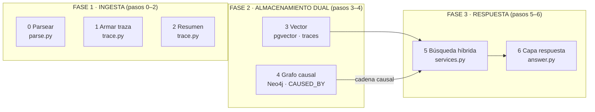

# El RAG de logs de project-trucha, explicado para que se entienda

> **El evador (20 segundos):** project-trucha tiene un **traductor universal de registros**.
> Le tiras cualquier papel (log), prolijo o garabateado, y él lo **lee, le arma la historia
> (traza), la guarda en dos archivos (uno por "significado", otro por "causa y efecto")**,
> y después **contesta preguntas** buscando en ambos. Lo genial: funciona igual aunque los
> papeles sean un desastre, y lo hace todo sin internet ni claves de API.

---

## El turista (2 minutos)

### La metáfora ancla: el detective forense

Imaginá una **mesada de un archivo policial llena de papeles** de un mismo incidente:

- Algunos papeles son **declaraciones prolijas**: legibles, con fecha y firma, cada uno
  señalando "esto pasó porque esto".
- Otros son **anotaciones al margen garabateadas**: mezcladas, sin año, con abreviaturas
  (`warn`, `pay_88`, `trc=...`), algunas pegadas a contramano (stack traces).

Un **detective forense** (nuestro sistema) hace lo siguiente:

1. **Lee cada papel** aunque esté garabateado → lo **transcribe a una ficha normalizada**.
2. **Junta todas las fichas del mismo incidente** en un expediente cronológico (la **traza**)
   y escribe **un resumen narrativo de qué pasó** ("Pago rechazado del usuario u_7f por $99").
3. **Guarda el resumen** en dos archivos distintos:
   - Uno por **"parecido de significado"** (el vector) — tipo índice por tema.
   - Uno por **"causa y efecto"** (el grafo) — tipo cronología con flechas de quién causó qué.
4. **Cuando le preguntan**, busca en los dos archivos a la vez y entrega una respuesta
   **con las pruebas citadas**.

> **El truco (contraste):** el mismo incidente narrado **prolijo** o **garabateado** produce
> **el mismo significado final**. Eso es la "virtud central" del proyecto, y también su prueba
> de honestidad: el sistema **marca la confianza** de cada dato según lo prolijo que estuviera.

### El mapa del pipeline (los 6 pasos → 3 fases)

Para no abrumarte, agrupamos los 6 pasos en **3 fases** (chunk de 3):

```
   FASE 1: INGESTA            FASE 2: ALMACENAMIENTO DUAL    FASE 3: RESPUESTA
   ┌──────────────┐          ┌─────────────────────────┐    ┌──────────────┐
   │ 0 Parsear    │          │  3 Vector (pgvector)    │    │ 5 Buscar     │
   │ 1 Armar traza│          │  4 Grafo causal (Neo4j) │    │ 6 Responder  │
   │ 2 Resumir    │          │                         │    │              │
   └──────┬───────┘          └─────────────────────────┘    └──────────────┘
          │  "lo entendí"              ▲  "lo guardé"             │
          └────────────────────────────┴─────────────────────────┘
```



**Recapitulemos (espaciado):** no sigas hasta acordarte de las **3 fases** y **qué es una
"traza"** (el expediente cronológico resumido). Ese resumen es la estrella del sistema porque
**es lo que se guarda y se busca**.

---

## El ingeniero (a fondo)

Aquí bajamos el detalle real. Cada componente va con su archivo, su rol y un **ejemplo trabajado**
al final que recorre el sistema completo.

### Fase 1 — Ingesta: tres sub-pasos

#### Paso 0 · Parseo y reparación — `src/trucha/logs/parse.py`

Convierte **cualquier línea** a un "schema unificado":
`timestamp, trace_id, event_id, caused_by, service, level, message, user_id, payment_id,
metadata, source_quality, timestamp_inferred`.

- `parse_file()` (parse.py:277) lee el archivo línea por línea, llama `parse_line()` y a los
  eventos reparados **sin trace_id los degrada a `"low_confidence"`**.
- `parse_line()` es una **cascada de parsers** (en orden): `json.loads` (limpio) →
  `SLOPPY_RE` → `BARE_RE` → `STACK_RE` → `SYSLOG_RE` → `_from_logfmt()`. Si nada matchea, la
  línea se **descarta** (`None`).
- `parse_timestamp()` normaliza a ISO 8601 UTC (logfmt, epoch, API voyante, `Aug 15 09:47:15`…);
  si falta año/hora, completa con la **fecha de ingesta** y marca `timestamp_inferred=true`.
- `normalize_level()` / `normalize_service()` unifican sinónimos (`infoo→INFO`, `api-gw→api-gateway`).
- `_extract_user()` / `_extract_payment()` sacan `user_id` y `payment_id` del mensaje cuando no vienen explícitos.

#### Paso 1 · Armar la traza — `src/trucha/logs/trace.py`

`traces_from_events()` (trace.py:173) agrupa eventos por `trace_id` y los ordena por timestamp:

- `_assign_fallback_traces()` — eventos sin trace_id se agrupan por `usuario+servicio` en una
  ventana de **2 segundos** y se marcan `"low_confidence"`.
- `_assign_synthetic_event_ids()` — da un `event_id` **determinista** (hash blake2b de
  `trace|ordinal|timestamp|message`) a los que no lo tienen → permite `MERGE` idempotente en el grafo.
- `_resolved_caused_by()` (trace.py:140) — causalidad: **explícita** en logs limpios
  (`causal_confidence=1.0`) o **inferida** como el evento anterior (`0.6`). Si **toda** la traza es
  inferida, se degrada a `"repaired"`.
- `_worst_quality()` — el peor `source_quality` de la traza gana (`clean` > `repaired` >
  `low_confidence`): un solo evento reparado degrada la traza entera.

#### Paso 2 · Resumen narrativo — `src/trucha/logs/trace.py`

`build_summary()` (trace.py:58) produce el **artefacto que se vectoriza**, con tipado de historia
(`pago` / `usuario` / `infra`), outcome y monto:

```
Traza <id>: Pago rechazado del usuario u_7f por $99. Secuencia: api-gw: payment_failed ;
  payment-svc: decline ; db: no rows. Resultado: error.
```

**Recapitulemos (espaciado):** ¿ves cómo la **etiqueta de calidad** viaja con la traza desde el
paso 0? Un log garabateado empieza como `repaired`/`low_confidence` y esa marca llega hasta la
respuesta final. Ese hilo de "confianza" es un personaje que vas a redescubrir en el paso 5.

### Fase 2 — Almacenamiento dual

#### Paso 3 · Embeddings + vector store — `src/trucha/embed/local.py` + `src/trucha/store/`

`embed_text()` (embed/local.py:10) convierte el resumen en un **vector de 64 dimensiones**,
**local, determinista y sin dependencias**:

```python
for token in TOKEN_RE.findall(text.lower()):
    digest = blake2b(token.encode(), digest_size=16).digest()
    index = int.from_bytes(digest[:8], "big") % 64   # a qué bucket suma
    sign = 1.0 if digest[8] & 1 else -1.0            # signo según un bit
    vector[index] += sign
```

> **¡Ahá!** No sale ni un byte de tu máquina. Nada de API externa: es el sello del principio
> **local-first** del proyecto. Cada token "acumula" su presencia en un bucket con signo; dos
> textos con vocabulario parecido terminan con vectores que apuntan en dirección parecida.

Se guarda en la tabla `traces` (`TraceModel`, `store/models.py`) con
`embedding VECTOR(64)`, `outcome`, `source_quality`, `services/levels`, `user_id`, `payment_id`,
`status_code`, `source_path`, `event_count`. Es **único por `(source_path, trace_id)`** → re-ingesta idempotente.
Un índice **HNSW** de coseno (migración `0002_traces.py`) acelera la búsqueda por proximidad.

#### Paso 4 · Grafo causal — `src/trucha/graph/`

Escribe en **Neo4j** el mapa causa-efecto de cada traza.

- `build.py` — funciones **puras** que devuelven queries Cypher (testeables sin Neo4j):
  - Nodos: **Trace** (con `source_quality`), **LogEvent**, y por PUT **Service / User / PaymentID**.
  - Relaciones: **CAUSED_BY** (causa→efecto con `confidence` 1.0/0.6 en el arco), **PART_OF**
    (evento→traza), **EMITTED_BY** (evento→servicio), **INVOLVES** (traza→user/payment).
  - `build_trace_operations()` (build.py:85) arma todas las operaciones `{query, params}` de una traza.
- `client.py` — `GraphClient`: `sync_trace()`/`sync_traces()` aplican las operaciones en **una sola
  transacción write**, y `causal_chain()` (client.py:62) recupera la cadena `CAUSED_BY` en orden
  temporal con la **confianza** de cada eslabón (la consume el paso 5).

**Recapitulemos (espaciado):** dos magacenes, dos "índices" distintos del mismo resumen:
pgvector responde "¿qué **se parece** a mi pregunta?" y Neo4j responde "¿qué **causó** qué, en qué orden?".
Ambos leen el **mismo** resumen narrativo generado en el paso 2.

### Fase 3 — Respuesta

#### Paso 5 · Búsqueda híbrida — `src/trucha/services.py`

`hybrid_log_search()` (services.py:254) hace las 3 cosas de la doc:

1. **Semántica:** embedding de la pregunta → busca coseno en `traces.embedding` (pgvector, top-k).
2. **Causal:** con esos `trace_id`, pide la `causal_chain` al grafo (si hay grafo).
3. **Marca: `low_confidence = source_quality != "clean"`** y arma el resultado con `vector_score`
   y la cadena causal.

**Degradación segura:** si el grafo falla, la búsqueda **sigue** devolviendo trazas con cadena vacía
(no rompe por el grafo).

`ingest_logs()` (services.py:204) es el paso 3 de orquestación: parsea, genera trazas y las inserta
(skip idempotente), con stats `sources/parsed/traces/inserted/skipped/errors`. Un archivo corrupto
**no aborta** el resto.

Otras piezas: `reciprocal_rank_fusion()` (`retrieve/ranking.py`) — RRF `∑ 1/(60+rank)` — que también
usa el RAG de código.

#### Paso 6 · Capa de respuesta — `src/trucha/answer.py` + `src/trucha/llm/`

`answer_logs()` (answer.py:54):

1. Llama `hybrid_log_search()` por la evidencia.
2. Arma el prompt con `_build_prompt()` / `_format_evidence()` (traza, origen, niveles, servicios,
   status, resumen, cadena causal con confianza), instruyendo al modelo a marcar `[INFERIDA]/[REPARADA]`
   y **citar la traza** de cada dato.
3. `get_provider()` resuelve `""→NoneProvider`, `openai`, `anthropic`. **`NoneProvider`** = fallback
   determinista que devuelve el contexto etiquetado **sin API key** (local-first).

El resultado final: `{question, answer, provider, results}`.

### Ejemplo trabajado completo (concreción)

Sigamos un log **desprolijo** de principio a fin:

> Línea cruda: `[WARN] api-gw :: payment_failed (user u_7f, trc=reqId_88)`

| Paso | Qué pasa | Resultado concreto |
|---|---|---|
| 0 · parse | Cae en `BARE_RE`, `normalize_level`→`WARN`, `_extract_user`→`u_7f`, se respeta `reqId_88` como trace | `source_quality="repaired"`, `service="api-gw"` |
| 1 · traza | Se agrupa con las demás líneas de `reqId_88`; causalidad inferida → `0.6` | traza degradada a `"repaired"` |
| 2 · resumen | `build_summary` → "Pago rechazado del usuario u_7f …" | resumen narrativo |
| 3 · vector | `embed_text(resumen, 64)` → vector normalizado | fila en `traces` + HNSW |
| 4 · grafo | `build_trace_operations` → nodos + `CAUSED_BY` con `confidence=0.6` | Multi-magacén poblado |
| 5 · buscar | preguntás "¿por qué falló el pago de u_7f?" → top-k + `causal_chain` | trazas con `low_confidence=true` y cadena |
| 6 · responder | `answer_logs` arma el prompt; el LLM marca `[REPARADA]` y cita la traza | `answer` + `provider` |

---

## El sabio (conexiones y porqués)

Ahora que sabés el "cómo", el "por qué del diseño":

- **Por qué dos magacenes en vez de uno:** el vector es bueno recordando "parecido", pero no "causa".
  La cadena causal (quién causó qué) es justo lo que un operador quiere al diagnosticar un incidente.
  Cada magacén está optimizado para un tipo de pregunta; juntos se complementan (híbrido).
- **Por qué local-first / sin API keys:** garantiza que puedas probar y enseñar el sistema **todo
  el tiempo**, sin configurar credenciales. La deterministocidad y sin-dependencias hace los tests
  predecibles.
- **Por qué el hilo de confianza (`source_quality`):** el sistema es honesto sobre sus limitaciones.
  En lugar de mentir con datos dudosos, **los etiqueta** (`clean`/`repaired`/`low_confidence`) y se
  lo dice al LLM para que lo comunique. Es un patrón de "observabilidad de la confianza de los datos".
- **Trade-off típico:** todo vector local de 64d es mucho más simple que un embedding de un modelo
  grande → pierde matiz semántico, pero es **reproducible, barato y sin red**. Es una elección
  deliberada para un RAG didáctico.
- **Errores comunes de quien lo aprende:** confundir "traza" con "log" (la traza es el **expediente
  resumido**, no una línea); asumir que el grafo es obligatorio para responder (degradación segura:
  funciona solo con el vector); olvidar que el `source_quality` viaja de punta a punta.
- **Mapeo a conceptos generales:** esto es un **RAG (Retrieval-Augmented Generation)** estándar:
  un documento → chunks/trazas → embeddings → búsqueda → LLM. La variante acá es el **segundo
  recuperador causal** (Neo4j) que enriquece la evidencia con la relación causa-efecto.

---

## Quiz final (recuperación activa)

<details><summary><b>P1.</b> ¿Qué es una "traza" y por qué es lo que se guarda y se busca?</summary>
Es el **expediente cronológico resumido de un mismo incidente** (`trace_id`): los eventos ordenados
por timestamp, su resumen narrativo (`build_summary`) y su etiqueta de calidad. Se guarda porque es
el artefacto compacto y significativo que se vectoriza (paso 3) y se consulta (paso 5).</details>

<details><summary><b>P2.</b> Quién responde "¿qué se parece a mi pregunta?" y quién "¿qué causó qué?".</summary>
pgvector (búsqueda por coseno sobre `traces.embedding`) responde lo **parecido**; Neo4j
(`causal_chain` sobre `CAUSED_BY`) responde la **causa y efecto** en orden temporal.</details>

<details><summary><b>P3.</b> Un evento tiene `source_quality="repaired"` pero su traza tiene otros limpios.
¿Qué gana y por qué? ¿Qué pasa si toda la traza es inferida?</summary>
Gana el **peor** (`_worst_quality`): un solo evento reparado degrada la traza entera. Si **toda** la
causa es inferida, la traza baja a `"repaired"` (ver `_resolved_caused_by`).</details>

<details><summary><b>P4.</b> ¿Qué hace `NoneProvider` y por qué existe?</summary>
Es el **fallback determinista** del paso 6: devuelve el contexto etiquetado **sin API key**. Mantiene
el principio local-first y permite que el sistema responda siempre, aunque no haya LLM configurado.</details>

<details><summary><b>P5.</b> Si Neo4j se cae, ¿se rompe la búsqueda? ¿Por qué?</summary>
No. `hybrid_log_search` tiene **degradación segura**: si el grafo falla, captura la excepción y
devuelve las trazas con **cadena causal vacía** (services.py:254). La búsqueda semántica sigue sola.</details>

---

## Glosario

| Término | Significado |
|---|---|
| **Traza** | Expediente cronológico de un mismo `trace_id`: eventos ordenados + resumen narrativo. |
| `source_quality` | Confiabilidad del origen: `clean` (prolijo), `repaired` (parseado de desprolijo), `low_confidence` (sin trace_id, agrupado por heurística). |
| `causal_confidence` | Peso de una relación causa→efecto: `1.0` explícita, `0.6` inferida (orden temporal). |
| Embedding | Vector numérico que codifica el "significado" de un texto; los parecidos apuntan parecido. |
| HNSW | Índice de aproximación para búsqueda vectorial por coseno en pgvector. |
| RRF | Reciprocal rank fusion: `∑ 1/(60+rank)` para fusionar rankings de recuperadores. |
| `event_id` sintético | Hash determinista blake2b para logs sin ID estable → `MERGE` idempotente en Neo4j. |
| RAG | Retrieval-Agugemented Generation: recuperar evidencia y dársela al LLM para responder. |

---

*Generado por la skill `neuroscience-explainer` y validado contra el código real vía
`codebase-memory-mcp` (`check_index_coverage` limpio en los archivos citados).*
